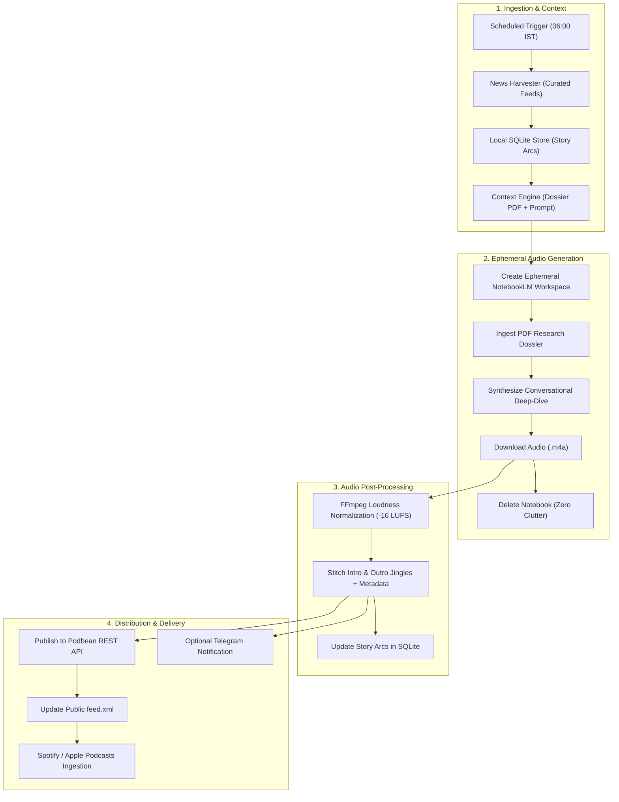
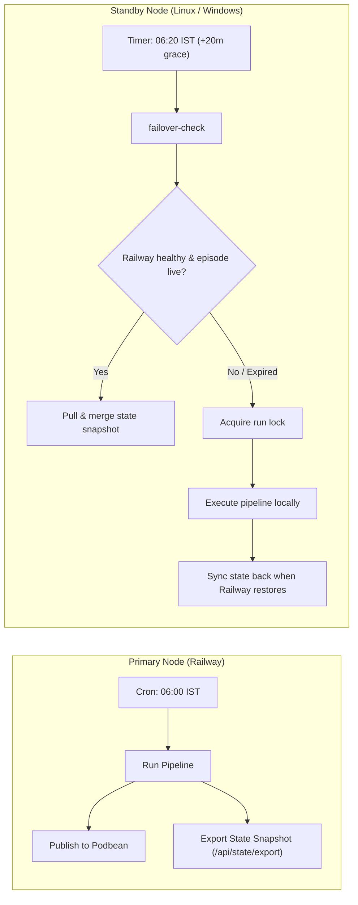

<div align="center">


# Autonomous Daily News Podcast Pipeline

**An autonomous, stateful morning news briefing pipeline powered by Google NotebookLM, Podbean, and FFmpeg.**  
Engineered for **Railway primary cloud execution** with **automatic local machine failover** (Linux & Windows) and zero external database costs.

[](https://python.org)
[](https://fastapi.tiangolo.com)
[](https://railway.com)
[](https://notebooklm.google.com)
[](https://ffmpeg.org)
[](https://www.podbean.com)
[](https://opensource.org/licenses/MIT)

</div>

---

## Overview

The **Daily News Podcast Pipeline** generates, masters, and syndicates a dynamic two-host conversational news briefing every morning without manual intervention.

Unlike typical scrapers or repetitive summaries, it maintains **contextual continuity** across episodes—tracking developing stories over time so that today's briefing naturally builds on what was reported yesterday instead of reciting stale facts.

### Key Highlights

- **Contextual Memory & Story Arcs**: Uses a local SQLite store to maintain running narratives across 7-day windows. Today's prompt explicitly highlights evolving updates ("*Following up on yesterday's lead...*").
- **Ephemeral NotebookLM Workspaces**: Spawns clean, isolated Google NotebookLM workspaces to generate deep-dive Audio Overviews, downloads the output, and tears down the notebook immediately to keep Google storage clutter-free.
- **Broadcast-Grade Audio Mastering**: Normalizes loudness to standard podcast levels (`-16 LUFS`), stitches custom intro/outro jingles, and tags ID3 metadata automatically with FFmpeg.
- **Hybrid Cloud + Edge Failover**: Runs on Railway on a scheduled cron. If Railway encounters datacenter rate-limits or cookie expiration, standby local machines (Linux `systemd` or Windows Task Scheduler) automatically detect the gap and complete the episode.
- **Zero Cloud Database Fees**: Eliminates external database bills by keeping state in local SQLite files and syncing delta snapshots over authenticated JSON REST endpoints (`/api/state/*`).
- **Headless Podcast Syndication**: Programmatically uploads finalized audio and metadata to Podbean via REST API, immediately propagating through RSS to Spotify and Apple Podcasts.
- **Real-Time Telegram Alerts**: Best-effort async notifications detailing harvest metrics, generation status, and audio mastering stages.

---

## System Architecture



---

## High-Availability Failover Topology

The pipeline uses a primary-standby failover architecture across Railway and local nodes:



1. **Railway Primary**: Runs the scheduled run (`06:00` by default). Podbean hosts the actual MP3 files and RSS feed, ensuring subscribers receive episodes even during server downtime.
2. **Local Standby**: Wakes at the cutoff window (e.g., `+20` minutes). If Railway is unreachable, missed today's run, or encountered an auth failure, the standby node acquires the run lock, verifies Podbean to prevent duplicates, generates the episode locally, and pushes updated state back to Railway when restored.

---

## Getting Started

### 1. Local Environment Setup

Using [`uv`](https://github.com/astral-sh/uv) (recommended) or standard `venv`:

```bash
# Clone the repository
git clone git@github.com:mochiron-desu/daily-new-podcast.git
cd daily-new-podcast

# Setup virtual environment and dependencies
uv venv
source .venv/bin/activate          # On Windows: .venv\Scripts\activate
uv pip install -r requirements.txt

# Optional: Interactive browser login on local machine
uv pip install "notebooklm-py[browser]"
playwright install chromium
notebooklm login
```

Configure your local environment:

```bash
cp .env.example .env
```

Verify your setup, ffmpeg installation, and credentials:

```bash
python -m src.cli doctor
```

Test the news harvesting, story clustering, dossier generation, and prompt building in dry-run mode (does not call NotebookLM or Podbean):

```bash
python -m src.cli run-once --dry-run
```

---

## Deployment

### 2. Deploying Primary to Railway

Railway runs the primary cron schedule and hosts the health/state API.

1. **Create Project**: Link this repository in [Railway](https://railway.com). The repository includes [`Dockerfile`](Dockerfile) and [`railway.toml`](railway.toml).
2. **Persistent Storage (Recommended)**: Attach a Railway Volume mounted at `/app/storage` so SQLite state and rotated session cookies persist across deployments.
3. **Export Local NotebookLM Session**:
   ```bash
   base64 -w 0 ~/.notebooklm/profiles/default/storage_state.json
   ```
4. **Set Railway Service Variables**:

| Variable | Description | Example / Recommended |
|---|---|---|
| `NODE_ROLE` | Primary coordinator | `primary` |
| `NODE_ID` | Node identifier | `railway-primary` |
| `NODE_PRIORITY` | Leader election priority | `0` |
| `API_TOKEN` | Bearer token for peer API state endpoints | `<long-random-secret>` |
| `STORAGE_DIR` | Mounted volume storage path | `/app/storage` |
| `TIMEZONE` | Schedule timezone | `Asia/Kolkata` |
| `PRIMARY_RUN_TIME` | Daily episode generation time | `06:00` |
| `NOTEBOOKLM_AUTH_B64` | Base64-encoded session state | `<base64-string>` |
| `NOTEBOOKLM_STORAGE_PATH` | Path to save refreshed cookies | `/app/storage/notebooklm_storage_state.json` |
| `PUBLISHER_BACKEND` | Podcast syndication backend | `podbean` |
| `PODBEAN_CLIENT_ID` | Podbean API client ID | `<podbean-client-id>` |
| `PODBEAN_CLIENT_SECRET` | Podbean API client secret | `<podbean-client-secret>` |

Railway monitors service health via the `GET /health` endpoint configured in `railway.toml`.

---

### 3. Setting Up Standby Failover (Linux & Windows)

Configure `.env` on your fallback machine:

```env
NODE_ROLE=fallback
NODE_ID=my-desktop             # Unique identifier per node
NODE_PRIORITY=10               # Lower number = higher priority
API_TOKEN=<same-secret-as-railway>
PRIMARY_URL=https://<your-railway-app>.up.railway.app
PODBEAN_CLIENT_ID=<your-podbean-client-id>
PODBEAN_CLIENT_SECRET=<your-podbean-client-secret>
```

#### Linux (`systemd` user timer)

```bash
chmod +x scripts/install_linux_systemd.sh
./scripts/install_linux_systemd.sh

# Optional: include --with-standby to run the local HTTP peer server for Tailscale peer election
./scripts/install_linux_systemd.sh --with-standby
```

#### Windows (Task Scheduler)

Run in PowerShell from the repository root:

```powershell
powershell -ExecutionPolicy Bypass -File .\scripts\install_windows_task.ps1

# Optional: include -WithStandbyDaemon to run the local HTTP peer server at user logon
powershell -ExecutionPolicy Bypass -File .\scripts\install_windows_task.ps1 -WithStandbyDaemon
```

---

## CLI Reference

| Command | Purpose |
|---|---|
| `python -m src.cli doctor [--live]` | Validates `ffmpeg`, NotebookLM auth, Podbean credentials, and node connectivity. |
| `python -m src.cli run-once [--dry-run]` | Executes the full podcast pipeline for today immediately. |
| `python -m src.cli failover-check [--force]` | Queries Railway / peer nodes and executes locally if the primary missed its window. |
| `python -m src.cli sync-state` | Fetches and merges `story_arcs` and `episodes` from primary or peer nodes. |
| `python -m src.cli status` | Displays JSON status of today's run, storage usage, and active story arcs. |
| `python -m src.cli serve` | Runs the FastAPI server with scheduled runner and peer synchronization endpoints. |

---

## Configuration (`config.yaml`)

Customizable settings in [`config.yaml`](config.yaml):

- **Feeds & Weights**: Curated RSS sources categorized by National, Business, World, and Tech with individual priority weightings.
- **Story Arcs & Clustering**: Adjustable similarity thresholds (`cluster_similarity_threshold: 0.22`) and stale arc retention limits (`stale_arc_days: 7`).
- **Audio Styling**: Selectable formats (`deep-dive`, `brief`, `critique`, `debate`), target LUFS (`-16.0`), and intro/outro jingle paths.
- **Telegram Notifications**: Optional bot token and chat ID to receive real-time status alerts.

---

## License

This project is licensed under the [MIT License](https://opensource.org/licenses/MIT).
